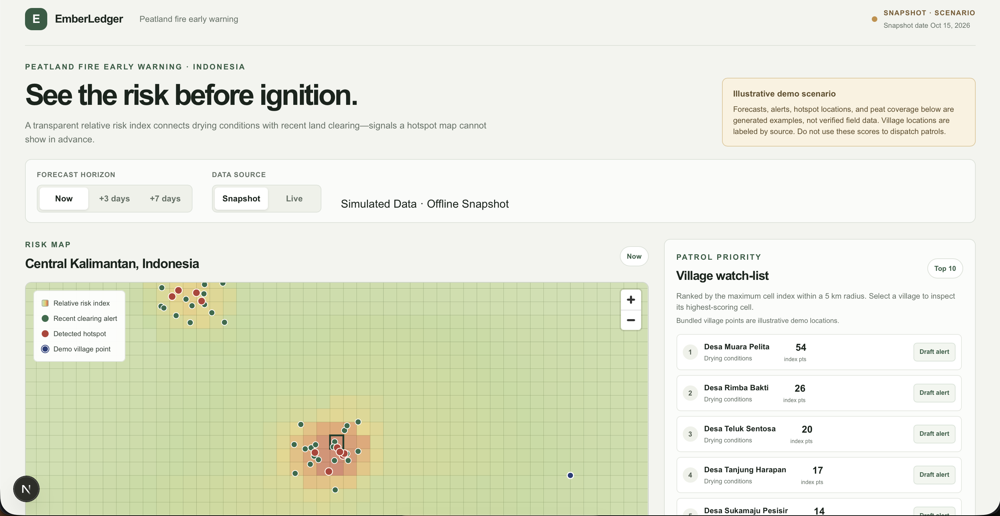
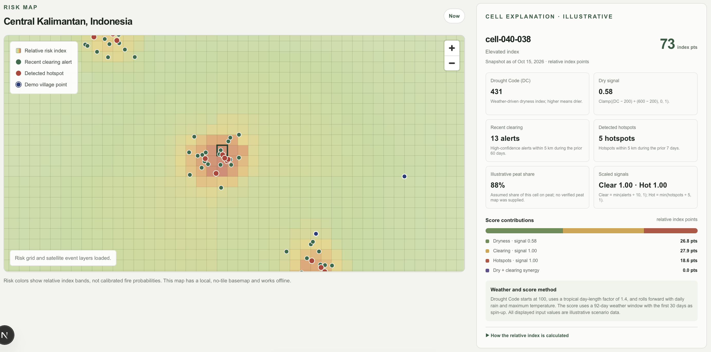

# EmberLedger

EmberLedger is an offline-first early-warning demo for peatland fire risk and
deforestation in Central Kalimantan, Indonesia. It combines drying conditions,
fresh forest-loss alerts, and recent hotspots into a transparent **relative
risk index** for now, +3 days, and +7 days. It is decision support, not a
probability, an official warning, or a validated operational forecast.

<p align="center">


</p>

## Run the demo

Requirements: Node.js 20.9 or newer.

```sh
npm install
npm run dev
```

Open [http://localhost:3000](http://localhost:3000). The bundled demo works
without network access in Snapshot mode. Use the visible mode switch to
demonstrate that Live mode explicitly falls back to the cached snapshot when
credentials, sources, or validated inputs are unavailable. No API keys are
needed to run the demo.

The precomputed grid and scenario snapshots in `public/data/` are the demo
fixture. To rebuild them from scratch:

```sh
npm run grid
npm run demo-data
npm run snapshot
npm run replay-data
npm run backtest
```

`npm run demo-data` intentionally creates illustrative inputs. Do not describe
their values or replay events as observed satellite or weather evidence.

## Three-minute demo

1. Open the dashboard in Snapshot mode; point out the Central Kalimantan AOI,
   the now / +3 / +7 day controls, and the visible scenario-data disclosure.
2. Click a cell. Explain its score using the dryness, clearing, hotspot, peat
   coverage, and synergy contributions in the detail panel; emphasize that the
   score is an index, not a probability.
3. Open the ranked village watch-list and draft an Indonesian alert. The
   generated message is deterministic, labeled illustrative, and explicitly
   says it is not an official warning.
4. Switch to Live mode to show the explicit snapshot fallback, then use Replay
   to scrub illustrative as-of checkpoints and inspect the following-week
   event markers.
5. Point out the backtest status. Metrics remain unavailable until a verified,
   non-synthetic historical archive is supplied.

## Verify

```sh
npm run test
npm run lint
npm run build
```

## Deploy to Vercel

The static scenario snapshots and local MapLibre worker are included in the
deployment. No credentials are required for the offline demo; Live mode
continues to fall back to snapshots until live scoring and its inputs are
configured and validated.

1. Install dependencies and confirm the production build locally:

   ```sh
   npm install
   npm run build
   ```

2. Authenticate with Vercel and link this project (the first command opens the
   browser login; the second asks you to select or create a Vercel project):

   ```sh
   npx vercel login
   npx vercel link
   ```

3. Deploy a preview, review the URL, then deploy the same project to production:

   ```sh
   npx vercel
   npx vercel --prod
   ```

   Alternatively, connect the repository in the Vercel dashboard and deploy
   from its default Next.js build settings. Do not add API credentials unless
   needed, and configure any secrets as server-side Vercel environment
   variables, never as `NEXT_PUBLIC_*`.

## Data and configuration

The default AOI is configured in `src/lib/config.ts`. All scoring weights,
normalization limits, and synergy thresholds are defined in that file. The
Drought Code implementation and its unit tests live in `src/lib/engine/dc.ts`
and `src/lib/engine/dc.test.ts`.

The bundled `source-snapshot.json`, grid, risk snapshots, village locations,
and replay checkpoints are illustrative fixtures. The snapshot date is fixed
for repeatable demos. The application labels scenario data and never presents
the fixture as observed source data.

Optional server-only credentials and configuration can be placed in
`.env.local` using `.env.example` as a guide:

- `FIRMS_MAP_KEY` for NASA FIRMS
- `GFW_API_KEY` and `GFW_ALERTS_GEOJSON_URL` for Global Forest Watch alerts
- `FIRMS_SOURCE` for the FIRMS feed selection

Never put credentials in client code. The Live toggle currently probes
available adapters but deliberately falls back to the bundled snapshot:
integrated live scoring remains disabled until source schemas, an AOI-verified
peat mask, and validated inputs are available. Open-Meteo does not require an
API key. `npm run probe` prints raw source responses for inspection; it does
not silently infer unverified field names. `npm run fetch-villages` requests
village points from Overpass and updates the village cache used by the
watch-list; public Overpass availability is not guaranteed.

To use a legally usable peat boundary clipped to the AOI, place it at
`public/data/peat.geojson`, then run:

```sh
npm run build-peat-fraction
npm run snapshot
npm run replay-data
```

The script samples nine points per grid cell and writes
`public/data/peat-fraction.json`. Without that file, snapshots use the
illustrative peat coverage fixture. A real peat boundary does not make the
overall risk output empirical while the other inputs remain illustrative.

## API routes

- `GET /api/risk?horizon=0|3|7&mode=snapshot|live` returns cell-level scores
  and per-factor contributions. Invalid horizons return HTTP 400.
- `GET /api/layers/alerts` and `GET /api/layers/hotspots` return event layers.
- `GET /api/watchlist` returns the ranked villages.
- `POST /api/message` drafts an Indonesian or English deterministic alert.
- `GET /api/replay?asof=YYYY-MM-DD` returns a bundled illustrative checkpoint.
- `GET /api/backtest` returns empirical metrics when verified input is
  supplied; otherwise it reports `unavailable`.
- `POST /api/ingest/sensor` validates the demo sensor-ingest contract and
  returns HTTP 202. It does not persist data.

## Backtest input and limitations

The backtest pipeline intentionally refuses synthetic input. It accepts
`public/data/backtest-input.json` with this shape:

```json
{
  "provenance": "Describe the verified archive and its source",
  "isSynthetic": false,
  "observations": [
    {
      "asOfDate": "2024-07-01",
      "cells": [
        {
          "id": "cell-id",
          "peatFrac": 0.8,
          "risk": 65,
          "hotspotDates": ["2024-07-04"]
        }
      ]
    }
  ]
}
```

Supply at least two dated observations, with each cell's `hotspotDates` limited
to the seven days after its as-of date, then run `npm run backtest`. Do not
label a computed retrospective ranking as forecast skill: observed weather
does not test forecast skill, and satellite detection/alert latency can affect
the result. Without a verified historical archive, metrics and lead time
remain unavailable; the replay is an illustrative interaction demo, not a
past-season reconstruction.
# EmberLedger-Peatland-Fire-Early-Warning
